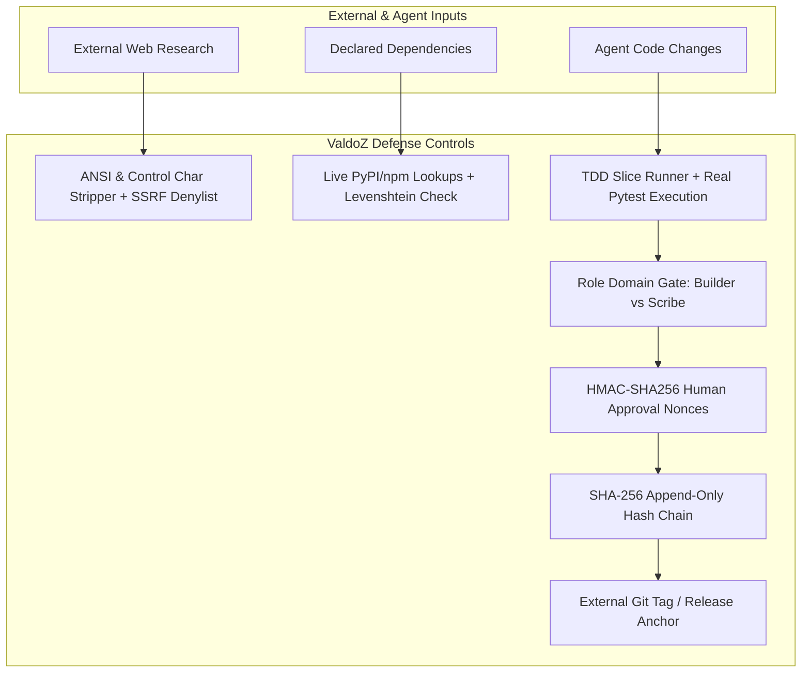

# ValdoZ Protocol: Threat Model & Security Architecture

This document formalizes the threat landscape, adversary assumptions, security boundaries, and defense-in-depth controls implemented in ValdoZ Protocol.

---

## 1. Adversary Model & Assumptions

ValdoZ defends delivery pipelines against four distinct threat actors:

| Adversary | Profile & Capabilities | Attack Vectors |
| :--- | :--- | :--- |
| **A1: Unconstrained / Hallucinating AI Agent** | Autonomous coding agent operating in the local workspace with write access to repository files. | Overwriting approved files, skipping verification phases, inventing phantom dependencies (slopsquatting), fabricating test results, auto-approving its own work. |
| **A2: Untrusted External Web Content** | Third-party web pages, documentation sites, or API responses retrieved during automated research. | Prompt injection embedded in HTML comments, terminal escape sequences (`\x1b`), invisible command injection, SSRF targeting cloud metadata (`169.254.169.254`). |
| **A3: Malicious Supply-Chain Actor** | Upstream attacker publishing malicious packages on package registries or unpinned GitHub Actions. | Typosquatting common package names, introducing viral copyleft licenses into proprietary repos, poisoning CI runners with mutable action tags. |
| **A4: Compromised Developer Machine** | Host environment where multiple Git accounts share credentials or local files. | Accidental commits with wrong identity, host credential leakage, retroactive audit log tampering. |

---

## 2. Security Boundaries: Guarantees vs. Speed Bumps

To maintain cryptographic rigor, ValdoZ explicitly distinguishes between **cryptographic guarantees** and **local speed bumps**:

### Cryptographic Guarantees (Root of Trust)
- **Hash-Chained Audit Ledger**: Each entry in `.valdoz/approvals.log` computes a SHA-256 hash chaining back to the previous entry. An edit or deletion at line $N$ breaks all subsequent links.
- **External Anchoring**: The audit log head is anchored externally via Git tags (`valdoz-anchor-<hash>`) and `.valdoz/anchor.json`. An attacker cannot secretly rewrite the entire chain without detection.
- **HMAC-SHA256 Approval Signatures**: Human approval tokens require valid 256-bit signatures with random nonces, timestamps, and 5-minute TTL. Unsigned or predictable tokens are cryptographically rejected.
- **Live Registry Verification**: Packages are actively checked against official PyPI and npm registries using HEAD requests before build phase progression.

### Local Operational Speed Bumps (Defense-in-Depth)
- **`chmod 444` Read-Only Deliverables**: Protects deliverables and `state.json` from accidental agent overwrites.
  > *Note*: The local file owner has OS permissions to `chmod` back. This is designed as a barrier against runaway agent tools, not a kernel-enforced capability barrier.
- **Interactive TTY Verification**: Rejects subshells and cron executions during `valdoz phase approve`.
- **Git Pre-Commit Hooks**: Enforces Builder vs. Scribe role domain separation locally before commits reach Git.

---

## 3. Defense-in-Depth Implementation Matrix

---

## 4. Out-of-Scope Non-Goals

1. **Kernel-Level Hypervisor Sandboxing**: ValdoZ runs within standard developer environments and does not replace container runtimes (e.g. Docker, gVisor) or OS-level sandboxes.
2. **Post-Deployment Runtime Exploits**: ValdoZ governs the pre-commit and pre-deployment delivery lifecycle; it does not perform live network intrusion detection or runtime WAF operations.
